<div align="center">

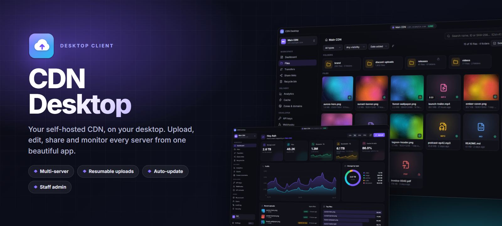

<br>

[](https://github.com/BallisticOK/CDN-Desktop/releases/latest)
[](https://github.com/BallisticOK/CDN-Desktop/releases)
[](https://github.com/BallisticOK/CDN-Desktop/actions/workflows/build.yml)
<br>
[](#-installation)
[](https://www.electronjs.org/)
[](https://react.dev/)
[](https://vitejs.dev/)
[](LICENSE)

**Manage every one of your self-hosted CDN servers from one fast, beautiful Windows app.**<br>
Upload, download, edit, share, purge and monitor, without ever opening the web dashboard.

[**⬇ Download**](https://github.com/BallisticOK/CDN-Desktop/releases/latest) &nbsp;·&nbsp;
[**✨ Features**](#-features) &nbsp;·&nbsp;
[**📸 Screenshots**](#-tour) &nbsp;·&nbsp;
[**🚀 Quick start**](#-quick-start) &nbsp;·&nbsp;
[**🛠 Build**](#-building-from-source)

</div>

---

## 📑 Contents

- [✨ Features](#-features)
- [📸 Tour](#-tour)
- [⬇ Installation](#-installation)
- [🚀 Quick start](#-quick-start)
- [⌨️ Keyboard shortcuts](#️-keyboard-shortcuts)
- [🔄 Auto-update](#-auto-update)
- [🔐 Security & privacy](#-security--privacy)
- [🧩 Architecture](#-architecture)
- [🛠 Building from source](#-building-from-source)
- [✍️ Code signing](#️-code-signing)
- [❓ FAQ](#-faq)
- [📜 License](#-license)

---

## ✨ Features

<table>
<tr>
<td width="50%" valign="top">

### 🌐 Multi-server accounts
Add as many CDN servers as you run, each with its own URL, API key, colour and defaults. Switch instantly from the sidebar or with <kbd>Ctrl</kbd>+<kbd>1</kbd>…<kbd>9</kbd>. Import or export your server list.

### 📁 A real file manager
Grid & list views, folders, breadcrumbs, search by name / ID / SHA-256, type & visibility filters and sorting. Drag files onto folders to move them. Right-click for everything.

### ⚡ Fast, resumable uploads
Drag in files **or whole folders** (structure is recreated), paste with <kbd>Ctrl</kbd>+<kbd>V</kbd>, or pick from a dialog. Files over 48 MB switch to the chunked API with **3 parallel chunks and automatic retries**.

### ☑️ Select mode & bulk actions
Normal clicks just open things. Flip on **Select** to get checkboxes, drag-a-box selection and <kbd>Ctrl</kbd>/<kbd>Shift</kbd>-click, then bulk download, copy links, move, change visibility, purge or delete files *and* folders together.

### 📝 Built-in code editor
Edit text files right on the CDN with syntax highlighting for 100+ languages. <kbd>Ctrl</kbd>+<kbd>S</kbd> saves a **new revision** (with conflict detection), and the edge cache is purged automatically.

</td>
<td width="50%" valign="top">

### 🖼 Rich previews
Images (with zoom), video, audio, PDF and text in a full-screen lightbox with arrow-key navigation.

### 🔗 Links made for Discord
One click copies a CDN URL, friendly path URL, expiring signed URL, Markdown or HTML. Create password-protected, expiring, download-limited **share links**.

### ⌨️ Quick-upload hotkey
Screenshot with <kbd>Win</kbd>+<kbd>Shift</kbd>+<kbd>S</kbd>, press <kbd>Ctrl</kbd>+<kbd>Alt</kbd>+<kbd>U</kbd>, and the link is on your clipboard. Works even when the app is hidden in the tray.

### 🛡 Staff sign-in & admin
Sign in with your dashboard account (2FA supported) to unlock what API keys can't do: **users, audit log, security events, API keys, webhooks, storage stats** and your own sessions.

### 📊 Analytics & operations
Traffic charts, status codes, countries, top files/keys/folders, cache hit ratio, bandwidth, usage & quotas. Purge or pre-warm caches, manage zones and domains, and call **any endpoint** from the built-in API console.

</td>
</tr>
</table>

<details>
<summary><b>📋 Full feature matrix</b></summary>
<br>

| Area | What you can do |
| --- | --- |
| **Files** | Browse, search, filter, sort · upload files/folders/clipboard · download (single or many) · rename · move · copy · delete with **undo** · visibility · cache-control · cache tags · force-download · custom metadata |
| **Revisions** | View history · upload a new revision (same ID & URLs) · roll back · delete revisions |
| **Images** | Signed transform builder: resize, crop/fit, format (WebP/AVIF/JPEG/PNG), quality, DPR, rotate, blur, greyscale |
| **Media** | List renditions · generate thumbnails, MP4 (H.264/H.265), WebM AV1, HLS, DASH, audio, waveforms |
| **Sharing** | Share links with password, expiry, max downloads, one-time, IP/country allow-lists, email capture · edit · bulk revoke · access log |
| **Recycle bin** | Search · restore · delete forever · empty bin · bulk actions |
| **Analytics** | 24h/7d/30d/90d · requests, bandwidth, downloads, errors, uploads, latency · breakdowns · recent errors · month-to-date usage |
| **Cache** | Purge by URL / file / folder / tag / zone / everything · pre-warm · purge history · stats |
| **Zones** | Domains, TLS & health · verify · health-check · set primary · replicate · zone settings (TTLs, referrers, geo rules, image/video options) |
| **Admin** *(staff)* | Users (invite, enable/disable, reset password/2FA, sign out, delete) · audit log · security events · API keys (create, scope, rotate, revoke) · webhooks (events, test, deliveries, replay) |
| **Account** *(staff)* | Roles & permissions · active sessions · sign out everywhere · change password |
| **API console** | Every endpoint from the server's live `openapi.json` · request builder · JSON body editor · response viewer · copy as cURL |
| **App** | Dark / light / system theme · custom accent colour · tray icon · notifications · transfers panel · auto-update |

</details>

---

## 📸 Tour

<div align="center">

### Dashboard
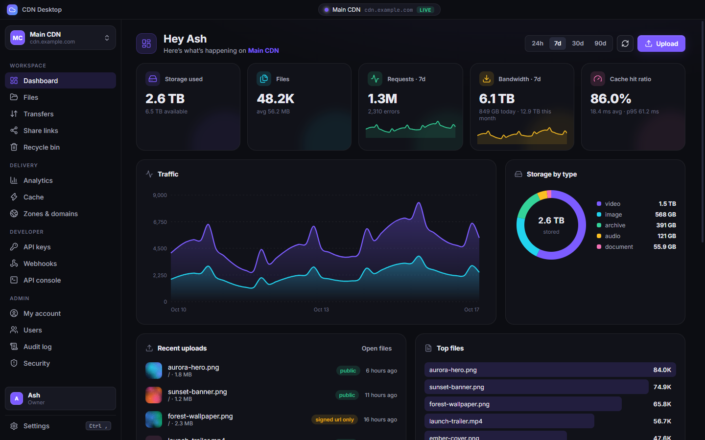

<sub>Storage, file count, requests, bandwidth and cache hit ratio at a glance, with live traffic charts.</sub>

</div>

<br>

<table>
<tr>
<td width="50%" align="center">
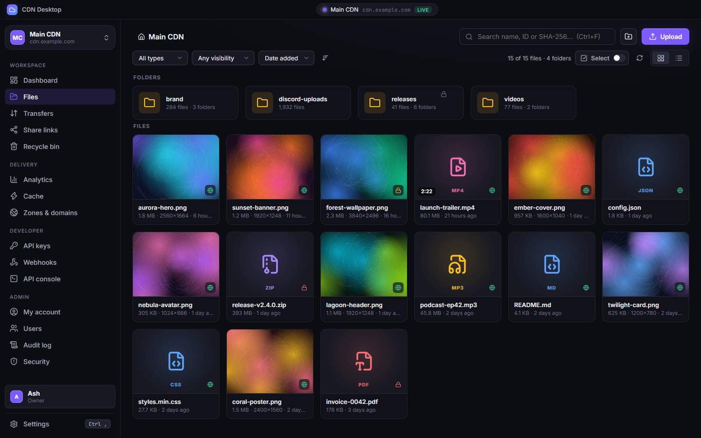<br>
<b>File manager</b><br><sub>Thumbnails, folders, visibility at a glance</sub>
</td>
<td width="50%" align="center">
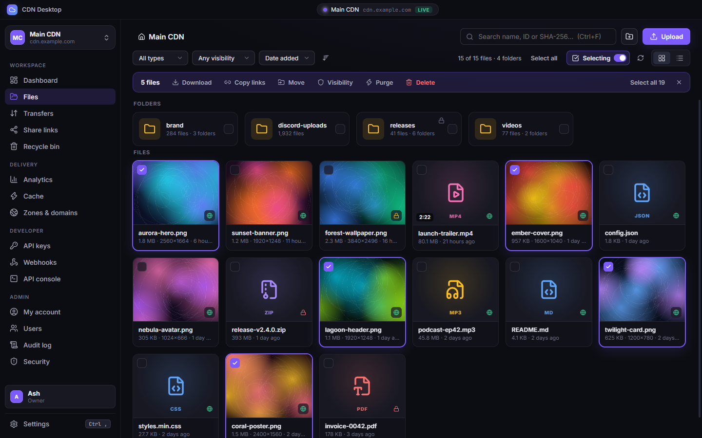<br>
<b>Select mode</b><br><sub>Checkboxes, drag-to-select, bulk actions</sub>
</td>
</tr>
<tr>
<td align="center">
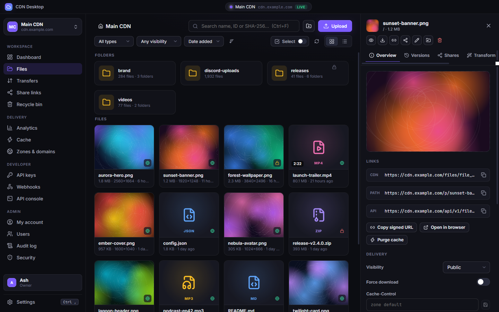<br>
<b>Details drawer</b><br><sub>Links, delivery settings, versions, shares, stats</sub>
</td>
<td align="center">
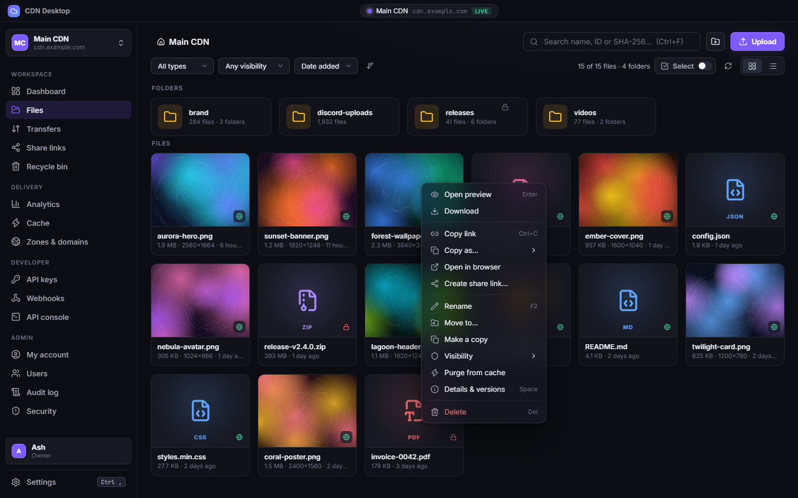<br>
<b>Right-click everything</b><br><sub>Copy as URL / Markdown / HTML, share, move, purge…</sub>
</td>
</tr>
<tr>
<td align="center">
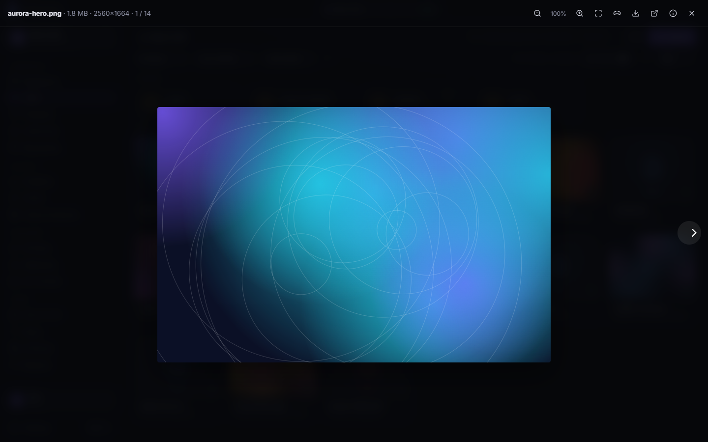<br>
<b>Lightbox preview</b><br><sub>Images, video, audio, PDF and text</sub>
</td>
<td align="center">
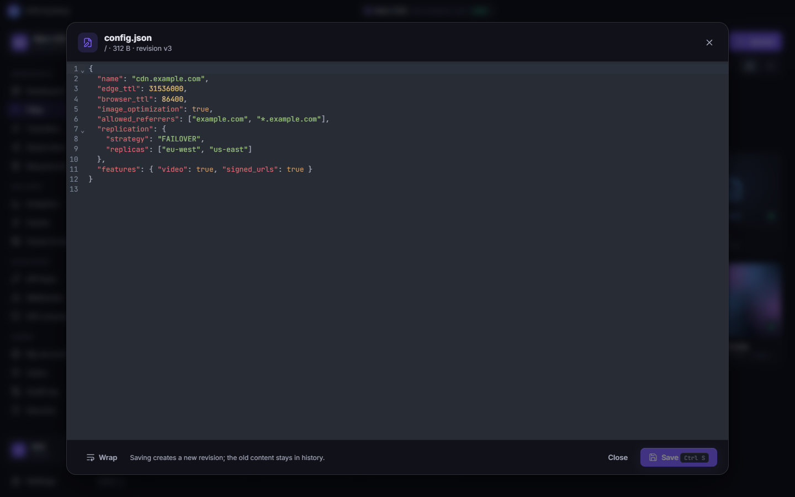<br>
<b>Code editor</b><br><sub>Edit on the CDN, every save is a revision</sub>
</td>
</tr>
<tr>
<td align="center">
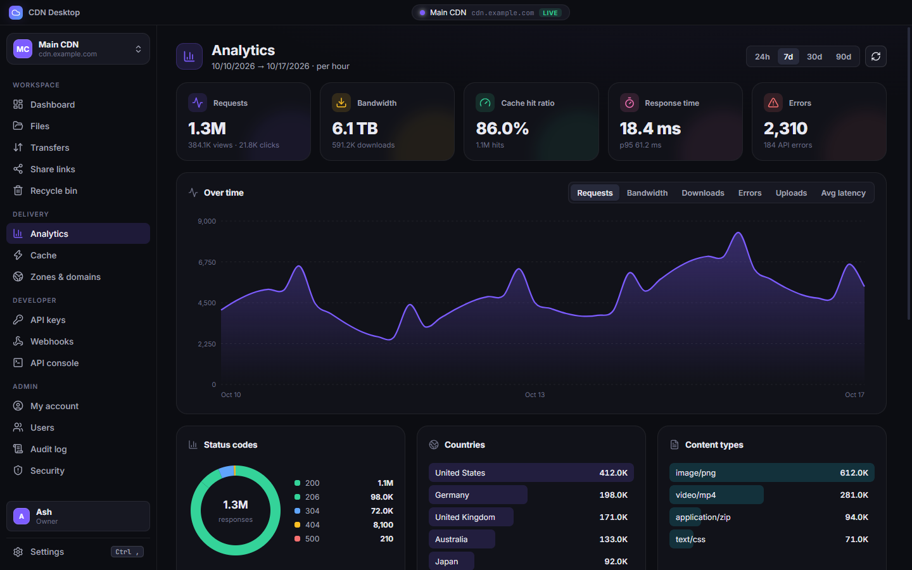<br>
<b>Analytics</b><br><sub>Traffic, status codes, countries, top content</sub>
</td>
<td align="center">
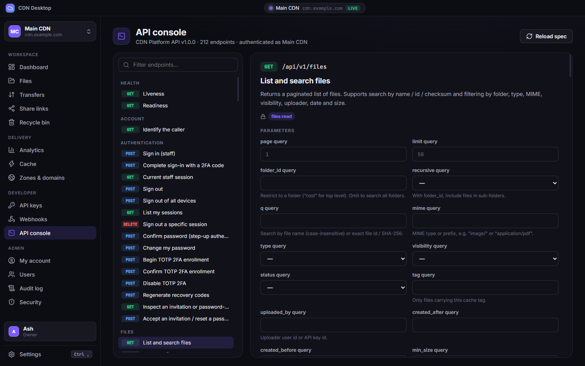<br>
<b>API console</b><br><sub>Every endpoint, straight from the server's spec</sub>
</td>
</tr>
<tr>
<td align="center">
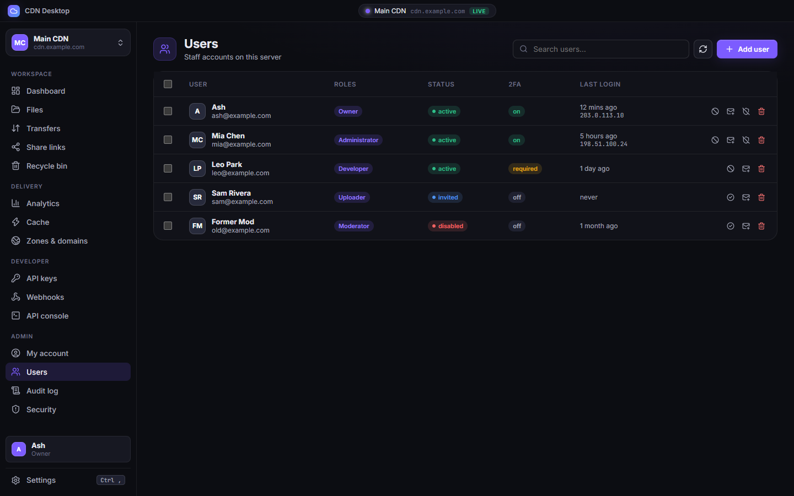<br>
<b>Users</b> <sup>staff</sup><br><sub>Invite, disable, reset 2FA, bulk actions</sub>
</td>
<td align="center">
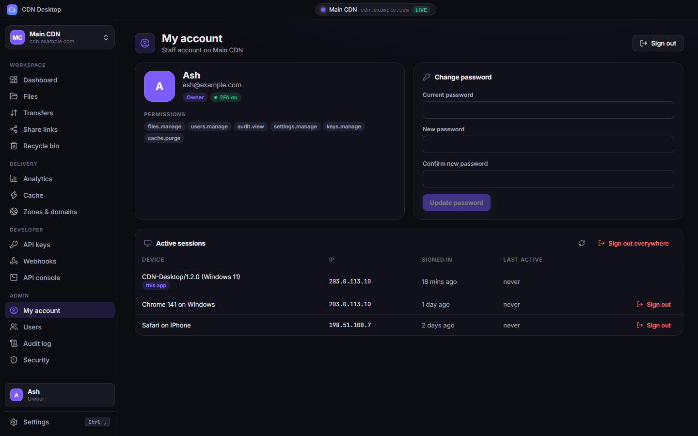<br>
<b>My account</b> <sup>staff</sup><br><sub>Permissions, sessions, password</sub>
</td>
</tr>
<tr>
<td align="center">
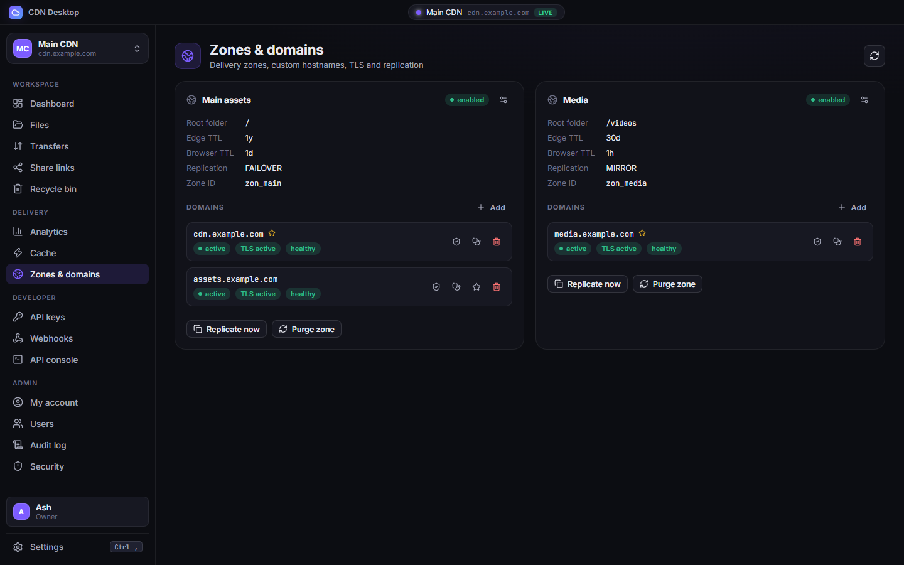<br>
<b>Zones & domains</b><br><sub>TLS, health checks, replication</sub>
</td>
<td align="center">
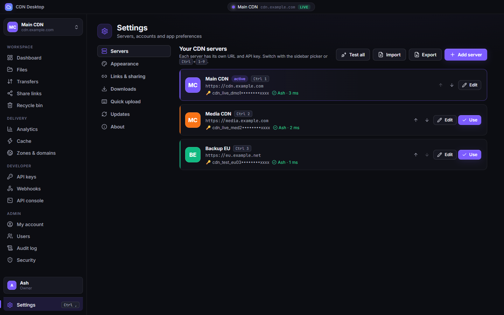<br>
<b>Servers</b><br><sub>Unlimited servers, live connection checks</sub>
</td>
</tr>
<tr>
<td align="center">
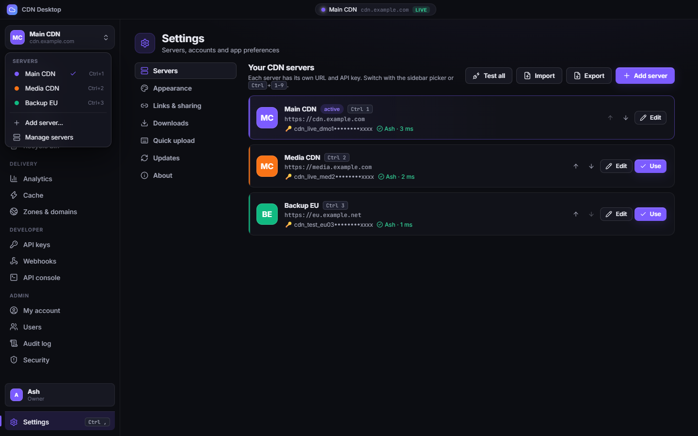<br>
<b>Instant switching</b><br><sub><kbd>Ctrl</kbd>+<kbd>1</kbd>…<kbd>9</kbd></sub>
</td>
<td align="center">
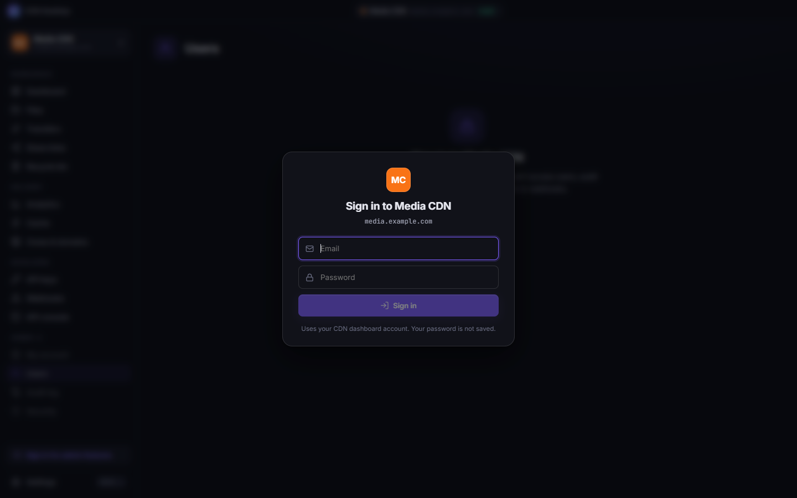<br>
<b>Staff sign-in</b><br><sub>Email + password + 2FA; password never stored</sub>
</td>
</tr>
</table>

<div align="center">

### 🌗 Dark, light or follow Windows
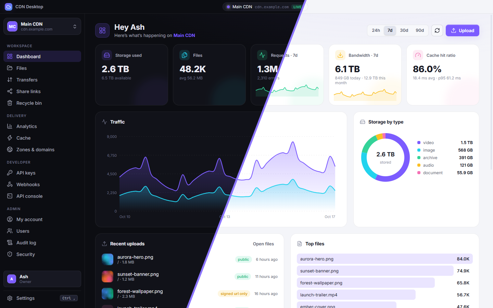

<sub>Pick any accent colour in Settings → Appearance.</sub>

</div>

---

## ⬇ Installation

Grab the latest build from the **[Releases page](https://github.com/BallisticOK/CDN-Desktop/releases/latest)**:

| File | Best for | Updates |
| --- | --- | --- |
| `CDN.Desktop-Setup-x.y.z.exe` | Most people: installs the app and adds Start-menu & desktop shortcuts | Silent in-place upgrade |
| `CDN.Desktop-x.y.z-portable.exe` | USB sticks, no-install machines, trying it out | Downloads the new portable exe and replaces itself |

> [!NOTE]
> Builds are not code-signed yet, so Windows SmartScreen may show *"Windows protected your PC"*. Click **More info → Run anyway**. See [Code signing](#️-code-signing).

**Requirements:** Windows 10 or 11 (x64) and a server running the CDN Platform API (e.g. `https://cdn.example.com/openapi.json`).

---

## 🚀 Quick start

1. **Create an API key** in your CDN's web dashboard (*API Keys → New key*). Pick the scopes you need, or all of them.
2. **Open CDN Desktop → Add your first server** and enter a name, the server URL and the key. Hit **Test connection** to confirm it works.
3. **Optional: sign in as staff.** Click **Sign in for admin features** in the sidebar to unlock users, audit logs, API keys, webhooks and storage stats.
4. **Add more servers** any time from the server picker (top-left) or *Settings → Servers*.

> [!TIP]
> Set **Settings → Links & sharing → "Copy link" uses** to *CDN URL* for links that embed nicely in Discord, or *Signed URL* for private files.

---

## ⌨️ Keyboard shortcuts

<table>
<tr><th>Anywhere</th><th>Files</th></tr>
<tr><td valign="top">

| Keys | Action |
| --- | --- |
| <kbd>Ctrl</kbd>+<kbd>1</kbd>…<kbd>9</kbd> | Switch server |
| <kbd>Ctrl</kbd>+<kbd>,</kbd> | Settings |
| <kbd>Ctrl</kbd>+<kbd>Alt</kbd>+<kbd>U</kbd> | Quick upload (global, configurable) |
| <kbd>Esc</kbd> | Close dialog / preview |

</td><td valign="top">

| Keys | Action |
| --- | --- |
| <kbd>Ctrl</kbd>+<kbd>A</kbd> | Select all (enters select mode) |
| <kbd>Ctrl</kbd>+<kbd>C</kbd> | Copy link(s) |
| <kbd>Ctrl</kbd>+<kbd>V</kbd> | Paste & upload |
| <kbd>Ctrl</kbd>+<kbd>F</kbd> | Search |
| <kbd>Del</kbd> · <kbd>F2</kbd> · <kbd>F5</kbd> | Delete · Rename · Refresh |
| <kbd>Space</kbd> · <kbd>Enter</kbd> | Details · Open |
| <kbd>Backspace</kbd> | Up one folder |
| <kbd>←</kbd> <kbd>→</kbd> · <kbd>+</kbd> <kbd>-</kbd> | Previous/next · zoom (preview) |

</td></tr>
</table>

---

## 🔄 Auto-update

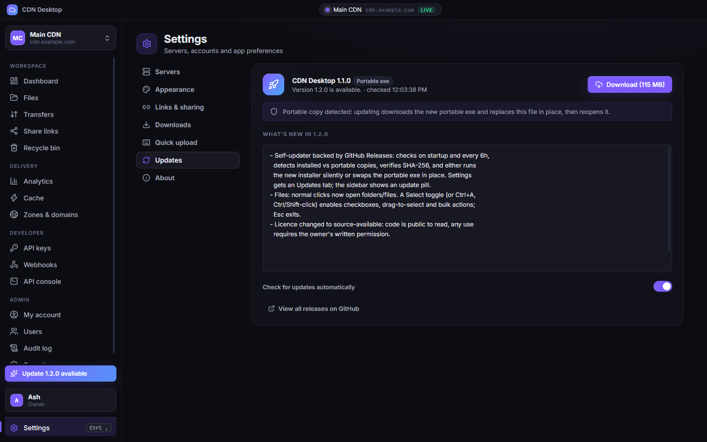

CDN Desktop checks GitHub Releases **on startup and every 6 hours** (toggle in *Settings → Updates*). Nothing is downloaded until you click.

- **Detects how it was installed.** The installed copy runs the new installer silently in the same folder and relaunches. The portable copy downloads the new portable exe and swaps it in place, keeping the same file name so your shortcuts keep working.
- **Verified downloads.** Every file is checked against the SHA-256 digest GitHub publishes for it before it's run.
- **Release notes in-app.** See what's new before you update.

---

## 🔐 Security & privacy

| | |
| --- | --- |
| 🔑 **API keys** | Encrypted at rest with **Windows DPAPI** (tied to your Windows account). They never reach the UI layer; all requests run in Electron's main process. |
| 🛡 **Staff sign-in** | Your password is **never stored**. Only the server's session cookie is kept, encrypted with DPAPI, and CSRF tokens are refreshed automatically. Sessions are only dropped when the server confirms they've expired. |
| 🖼 **Private previews** | Thumbnails and previews of private files go through an internal `cdnx://` protocol that adds credentials in the main process, so no tokens end up in page URLs. |
| 🌍 **No telemetry** | The app only talks to the servers you add and to GitHub (for update checks). |
| 🧱 **Hardened renderer** | Context isolation, sandboxed renderer, no Node integration, strict Content-Security-Policy in builds. |

Settings live in `%APPDATA%\cdn-desktop\config.json`.

---

## 🧩 Architecture

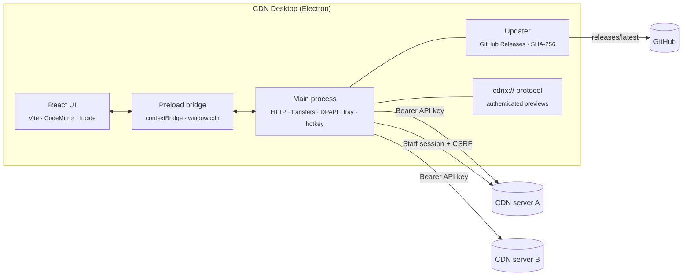

<details>
<summary><b>📂 Project layout</b></summary>

```text
CDN-Desktop/
├─ electron/
│  ├─ main.cjs          # window, tray, IPC, HTTP client, uploads/downloads, staff sessions
│  ├─ preload.cjs       # safe bridge exposed to the UI as window.cdn
│  ├─ updater.cjs       # GitHub Releases self-updater (installed + portable)
│  └─ icon.png
├─ src/
│  ├─ App.jsx           # shell, sidebar, routing
│  ├─ lib/              # API helpers, app state, shared actions
│  ├─ components/       # UI kit, charts, editor, preview, dialogs, sign-in
│  └─ pages/            # Dashboard, Files, Analytics, Admin, Settings, …
├─ scripts/             # Electron launcher, icon generator
├─ docs/                # README images
└─ .github/workflows/   # CI build, signing, releases
```

</details>

---

## 🛠 Building from source

> [!IMPORTANT]
> The code is **source-available, not open source**. Building your own copy requires written permission from the owners (see [License](#-license)).

```powershell
git clone https://github.com/BallisticOK/CDN-Desktop.git
cd CDN-Desktop
npm install
npm start          # build the UI and launch the app
npm run dev        # hot-reload development mode
npm run dist       # installer + portable exe → ./installer
```

Requires **Node.js 22+**. Every push to `main` is built by GitHub Actions; pushing a `v*` tag publishes a release:

```powershell
npm version patch        # bumps package.json and creates the vX.Y.Z tag
git push --follow-tags   # CI builds, signs (if configured) and publishes
```

---

## ✍️ Code signing

The workflow signs automatically once a certificate is configured in **Settings → Secrets and variables → Actions**; until then it builds unsigned.

<details>
<summary><b>Option A: code-signing certificate (.pfx)</b></summary>
<br>

| Secret | Value |
| --- | --- |
| `WIN_CSC_LINK` | the .pfx, base64-encoded: `[Convert]::ToBase64String([IO.File]::ReadAllBytes("cert.pfx")) \| Set-Clipboard` |
| `WIN_CSC_KEY_PASSWORD` | the .pfx password |

</details>

<details>
<summary><b>Option B: Azure Trusted Signing (about US$10/month)</b></summary>
<br>

| Type | Name | Value |
| --- | --- | --- |
| Secret | `AZURE_TENANT_ID`, `AZURE_CLIENT_ID`, `AZURE_CLIENT_SECRET` | app registration with the *Trusted Signing Certificate Profile Signer* role |
| Variable | `AZURE_SIGNING_ENDPOINT` | e.g. `https://eus.codesigning.azure.net` |
| Variable | `AZURE_SIGNING_ACCOUNT` | Trusted Signing account name |
| Variable | `AZURE_SIGNING_PROFILE` | certificate profile name |
| Variable | `AZURE_PUBLISHER_NAME` | publisher name on the certificate |

</details>

The build verifies the signature afterwards and fails if it's invalid.

---

## ❓ FAQ

<details>
<summary><b>Some pages say "Staff sign-in required". Why doesn't my API key work?</b></summary>
<br>
About 130 endpoints (storage stats, API keys, webhooks, users, audit logs, settings…) only accept a signed-in staff session. No API key can use them, whatever its scopes. Click <b>Sign in for admin features</b> in the sidebar and use your dashboard account.
</details>

<details>
<summary><b>Where are my settings and keys stored?</b></summary>
<br>
In <code>%APPDATA%\cdn-desktop\config.json</code>. API keys and sessions in that file are encrypted with Windows DPAPI, so the file is useless on another PC or Windows account. Use <i>Settings → Servers → Export</i> to move servers between machines.
</details>

<details>
<summary><b>Will updating lose my servers or settings?</b></summary>
<br>
No. Both the installer and portable updates leave <code>%APPDATA%\cdn-desktop</code> untouched.
</details>

<details>
<summary><b>Can I upload really big files?</b></summary>
<br>
Yes. Anything over 48 MB uses the resumable chunked upload API (chunk size set by the server, 3 chunks in parallel, each retried up to 4 times). Progress, speed and ETA are shown in <i>Transfers</i>.
</details>

<details>
<summary><b>Does it work with servers on different domains?</b></summary>
<br>
That's what it's built for: add each server with its own URL and key and switch between them instantly.
</details>

---

## 📜 License

**Source-available, not open source.** © 2026 [BallisticOK](https://github.com/BallisticOK) & [cachenetworks](https://github.com/cachenetworks). All rights reserved.

- ✅ You **may** read the code and run the official release builds for personal use.
- ❌ Without **written permission from one or both owners** you **may not** use, copy or fork the code for your own use, modify it, rebuild it, redistribute it or use it commercially.
- ⚖️ Unauthorised use is copyright infringement and will be met with takedowns and legal action.
- 🙋 Want to use it? [**Open an issue and ask**](https://github.com/BallisticOK/CDN-Desktop/issues/new) or contact [BallisticOK](https://github.com/BallisticOK) or [cachenetworks](https://github.com/cachenetworks).

See [LICENSE](LICENSE) for the full terms.

<div align="center">
<br>
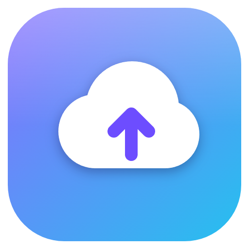<br>
<sub>Built with ❤️ for self-hosters · <a href="https://github.com/BallisticOK/CDN-Desktop/releases/latest">Download the latest release</a></sub>
</div>
